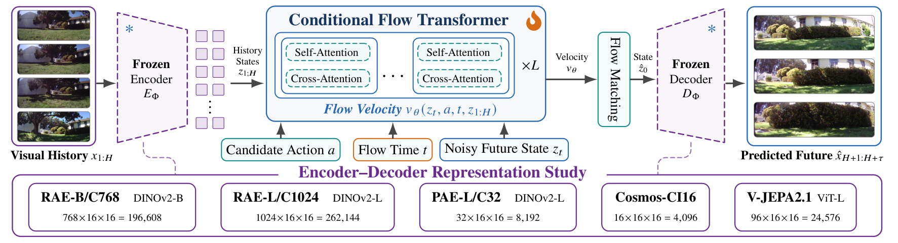

<div align="center">

# Visual Representation and History Modeling for Navigation World Models

**IEEE BigData 2026**

Guangfu Guo<sup>1</sup>, Xiaoqian Lu<sup>2</sup>, Rui Liu<sup>1</sup>, Yutong Chen<sup>1</sup>, Kunpeng Liu<sup>1</sup>, Long Cheng<sup>1</sup>

<sup>1</sup>Clemson University &nbsp;&nbsp; <sup>2</sup>University of Ottawa

[**Paper**](https://arxiv.org/pdf/2609.29555) &nbsp;|&nbsp; [**arXiv**](https://arxiv.org/abs/2609.29555) &nbsp;|&nbsp; [**Project page**](https://kwongfuk.github.io/nwm-rep-history/)

</div>

<p align="center">
  
</p>

We study two design choices of navigation world models within one conditional
flow-transformer framework: the **visual representation** the model predicts
in, and how it processes the **observation history** when a planner scores many
candidate actions against the same history.

- **No single best representation.** Among five frozen representations, PAE-L
  reconstructs best, RAE-B predicts best directly, and V-JEPA 2.1 is the most
  stable in long-horizon rollout.
- **Reusable history.** *Cached-Linear* summarizes the history once and reuses
  it for every candidate action; *Balanced GDN* keeps that cached history path
  (linear and shifted-window cross-attention) and mixes the target tokens with
  Gated Delta Network layers in every fourth block.
- **7.2× faster, 6.5× less memory** than Global-Softmax with 64 history frames
  and 120 candidate queries.

## Quick start

```bash
pip install -r requirements.txt
export NWM_DATA_ROOT=/path/to/datasets NWM_MODEL_ROOT=/path/to/models NWM_RUN_ROOT=/path/to/runs

# train
torchrun --nproc_per_node=2 train.py --config config/main/rae_b_balanced_gdn.yaml --global-seed 42

# predict, then score the decoded images
torchrun --standalone --nproc_per_node=1 infer.py --exp config/main/rae_b_balanced_gdn.yaml \
  --datasets sacson --eval_type time --num_sec_eval 5 --checkpoint_path <ckpt> \
  --eval_index_dir data_splits/eval_indices/full16 --output_dir $NWM_RUN_ROOT/eval --seed 42
torchrun --standalone --nproc_per_node=1 evaluate.py --datasets sacson --eval_types time \
  --num_sec_eval 5 --gt_dir <gt_dir> --exp_dir <prediction_dir> --metrics dino,lpips,dreamsim
```

See [docs/GETTING_STARTED.md](docs/GETTING_STARTED.md) for installation,
data preparation, model assets and the full evaluation protocol.

Trained world-model checkpoints are not released; every result in the paper
can be reproduced by training from the configs in `config/` and evaluating on
the frozen sample sets in `data_splits/eval_indices/`.

| Folder | Contents |
|---|---|
| `nwm/` | model (CDiT + history mixers, GDN, iREPA), frozen tokenizers, data, utilities |
| `config/` | configs for Study I, the main experiment, ablations and the efficiency benchmark |
| `tools/` | efficiency benchmark and evaluation helpers |
| `data_splits/` | train/test trajectory lists and the frozen evaluation indices used in the paper |
| `RAE/` | RAE encoder/decoder and flow-matching transport (third party) |
| `LICENSES/` | license texts of third-party components |

## Citation

```bibtex
@inproceedings{guo2026nwm,
  title         = {Visual Representation and History Modeling for Navigation World Models},
  author        = {Guo, Guangfu and Lu, Xiaoqian and Liu, Rui and Chen, Yutong and Liu, Kunpeng and Cheng, Long},
  booktitle     = {Proceedings of the IEEE International Conference on Big Data (BigData)},
  year          = {2026},
  eprint        = {2609.29555},
  archivePrefix = {arXiv}
}
```

## Acknowledgements

Built on [RAE-NWM](https://github.com/20robo/raenwm),
[NWM](https://github.com/facebookresearch/nwm) and
[RAE](https://github.com/bytetriper/RAE). See [THIRD_PARTY.md](THIRD_PARTY.md)
for all third-party components. Our own code is released under the
[MIT license](LICENSE); files derived from NWM remain under CC BY-NC 4.0, so the
repository as a whole is for non-commercial use (see [THIRD_PARTY.md](THIRD_PARTY.md)).
